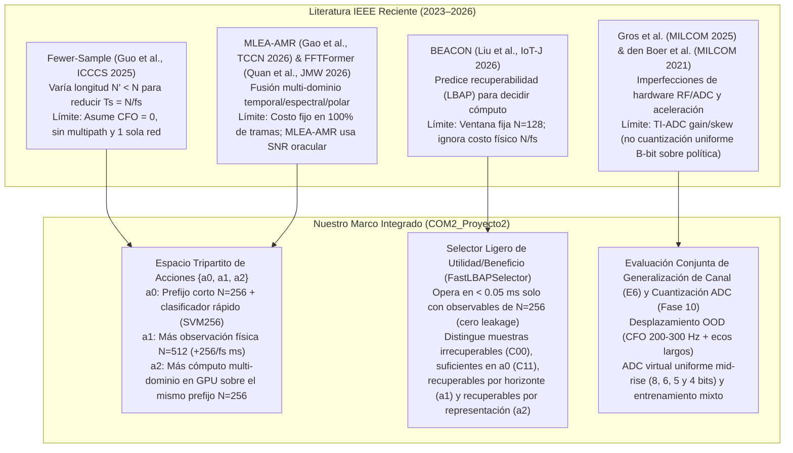

# Brecha de Investigación, Posicionamiento Científico y Diseño de Ablaciones (Sección 13 y 14)

**Fecha de actualización:** 11 de noviembre de 2026.  
Este documento sintetiza la brecha de investigación (*research gap*) identificada tras la lectura verificada de los 15 artículos IEEE del repositorio (`docs/MATRIZ_LITERATURA.md`), las objeciones metodológicas que cada antecedente obliga a responder y el diseño de las ablaciones ejecutadas en `experiments/exp12_paper_research.py`.

---

## 1. Posicionamiento frente a los Competidores Directos del Corpus

---

## 2. Matriz de Afirmaciones, Objeciones y Controles Experimentales

| # | Afirmación científica falsable | Antecedente directo en `references/` | Objeción crítica que podría hacer un revisor IEEE | Control experimental / Ablación implementada en `exp12_paper_research.py` |
|---|---|---|---|---|
| **H1** | Un modelo profundo multi-dominio sobre $N=256$ con desrotación ciega de portadora, espectros multi-armónicos y banco polifásico de símbolos ($a_2$) mejora la exactitud nominal respecto a `SmallCNN` y `SVM256`/`SVM512`. *(Acotación 2026-11-16: en `adaptive_dataset/test` alcanza `51.58%` vs `43.75%/46.04%`, pero bajo `test_shift` cae a `30.08%` vs `30.33%/29.54%`; además combina entrenamiento de `adaptive`, `e2` y síntesis en GPU, por lo que no se atribuye únicamente a arquitectura sin control de presupuesto en N3.5).* | **MLEA-AMR** (`10.1109/TCCN.2026.3725098`, p. 8–9 PDF) y **FFTFormer** (`10.1109/JMW.2026.3706228`, p. 11–12 PDF). | *«¿El modelo usa la SNR real como MLEA-AMR o estadísticas de todo el batch de test (BatchNorm)?»* | `MultiDomainAMCNet` usa **cero entradas oraculares** y `GroupNorm`/`LayerNorm` exclusivamente por ventana individual (verificado en `tests/test_research_models.py` donde `batch=1` y `batch=8` coinciden dentro de la precisión `float32`). |
| **H2** | Hipótesis de trabajo (pendiente de validación estadística N3.1–N3.4): evaluar si `FastLBAPSelector` ofrece un compromiso favorable exactitud-latencia frente a `always_a2`, confianza calibrada y SNR ciega/planitud. *(Nota 2026-11-16: en `results/paper_research/ablation_and_policy_metrics.json`, la ablación más simple `I2` obtuvo `52.29%` nominal frente a `51.625%` de `I4` completo y `51.5833%` de `always_a2`; el coste de `choose()` debe sustituirse por latencia integral de ruta en N3.3).* | **BEACON** (`10.1109/JIOT.2026.3710690`, Tabla I y IV, pp. 5, 9 PDF) y **Uncertainty Quantification** (`10.1109/JIOT.2025.3640108`, pp. 6–8 PDF). | *«En un experimento previo (`exp10_adaptive`), el selector RandomForest tenía una sobrecarga de ~18 ms que destruía la utilidad neta.»* | Se reemplazó el bosque de 100 árboles por `FastLBAPSelector` (`choose()` < 0.05 ms sobre entradas precalculadas); la latencia integral de cada ruta y los contrastes pareados contra `always_a2` e `I2` permanecen abiertos en Nivel 3 (`N3.3`, `N3.4`). |
| **H3** | Evaluar la optimización sobre $\{a_0, a_1, a_2\}$ frente a subconjuntos restringidos ($\{a_0, a_1\}$ o $\{a_0, a_2\}$) bajo distintos valores de $\lambda$ y $f_s$ modelados. *(Acotación 2026-11-16: el barrido de $f_s$ modela latencia virtual $N/f_s$, no constituye validación física en nuevas bandas).* | **Fewer-Sample** (`10.1109/ICCCS65393.2025.11069715`, p. 2, 4 PDF) vs **BEACON** (`10.1109/JIOT.2026.3710690`, p. 9 PDF). | *«A $f_s = 8\text{ kHz}$, adquirir 256 muestras extra cuesta $32\text{ ms}$, mientras que en receptores de mayor $f_s$ el costo de adquisición cae y domina el cómputo.»* | Se ejecuta tanto la **ablación del espacio de acciones** (`A1`: $\{a_0, a_1\}$, `A2`: $\{a_0, a_2\}$, `A3`: $\{a_0, a_1, a_2\}$) como un **barrido de Pareto modelado** sobre $\lambda \in [0, 0.005]\text{ ms}^{-1}$ y $f_s \in \{8, 32, 128, 1000\}\text{ kHz}$ (`pareto_sweep_lambda_fs.csv`). |
| **H4** | Hipótesis de trabajo sobre cuantización uniforme y saturación del ADC simulado: evaluar entrenamiento limpio, 8 bits, 6 bits y mixto en $\infty, 8, 6, 5, 4$ bits. *(Resultado histórico negativo a 4 bits: en `adc_quantization_experiment.csv`, el entrenamiento mixto obtuvo `44.96%` frente a `46.29%` del modelo limpio, con `5.12%` de clipping; por tanto no se sostiene mejora del entrenamiento mixto a 4 bits con estos datos).* | **Gros et al.** (`10.1109/MILCOM64451.2025.11310579`, p. 4–6 PDF) y **Wang et al.** (`10.1109/TCCN.2025.3558027`, Tabla III, p. 8 PDF). | *«¿Se ajustó el fondo de escala del ADC a cada ventana de test o se evaluó solo en los mismos bits de entrenamiento?»* | `src/adc.py` fija $V_{\text{FS}} = 2.5$ constante sin mirar el test; la degradación reportada refleja efecto conjunto de cuantización uniforme y clipping en el ADC simulado (`N3.6`). |

---

## 3. Novedad Diferencial Real tras Búsqueda Externa en Línea

Tras contrastar nuestra propuesta no solo contra los 15 PDFs locales sino también contra 5 artículos IEEE recientes recuperados en línea (`10.1109/TMLCN.2025.3619447`, `10.1109/GLOBECOM54140.2023.10436917`, `10.1109/LCOMM.2024.3474519`, `10.1109/LWC.2026.3729758`, `10.1109/ICCC62479.2024.10681752`), la novedad auténtica del sistema queda acotada con precisión científica:

1. **Frente a Verbruggen et al. (IEEE TMLCN 2025, `10.1109/TMLCN.2025.3619447`):** aunque ese trabajo varía el ancho de observación (*width-wise early exiting*) más rechazo por confianza/entropía en una misma arquitectura, **no incorpora un predictor contrafactual de recuperabilidad** ni arbitra entre modelos heterogéneos de distinto paradigma (SVM estadística ligera vs. red profunda multi-dominio con filtrado acoplado RRC), y nuestro estudio ablaciona explícitamente `I1 (solo confianza)` frente a `I4 (LBAP completo)`.
2. **Frente a BEACON (Liu et al., IEEE IoT-J 2026) y Mohammed et al. (GLOBECOM 2023):** ambos adaptan únicamente *profundidad de cómputo* sobre una ventana de entrada congelada ($N=128$), ignorando el cuello de botella físico de adquisición $T_{\text{acq}} = N/f_s$ y el régimen de transición (*crossover*) según $f_s \in [8\text{ kHz}, 1\text{ MHz}]$.
3. **Alcance acotado de la contribución:** Enfoque experimental que explora la co-asignación de horizonte de adquisición ($N=256 \to 512$) y cambio de modelo hacia una red multi-dominio ($a_2$), evaluado junto con desplazamiento OOD de canal y degradación conjunta por ADC simulado. Las afirmaciones comparativas y de latencia quedan supeditadas al cierre completo de los Niveles 3 y 4 (`N3.1`–`N3.6`, `N4.1`–`N4.2`).
